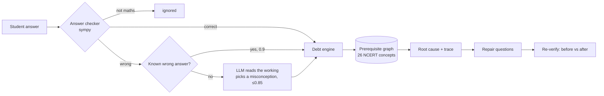
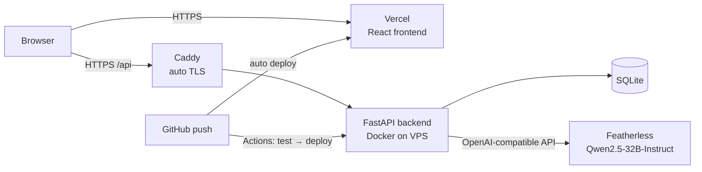

# Concept Debt

**A debugger for learning.** Concept Debt traces a student's repeated maths mistakes
back through the NCERT prerequisite chain to the one earlier concept that is actually
broken, gives a short targeted repair, and measures the improvement.

> *"You keep losing marks in Class 10 Quadratic Equations because of a gap in
> Class 7 Algebraic Expressions (the distributive property)."*

**detect → trace → repair → verify**

| | |
|---|---|
| **Live app** | https://concept-debt.vercel.app |
| **Live API** | https://api.94.249.197.142.sslip.io/api |
| **API docs (interactive)** | https://api.94.249.197.142.sslip.io/docs |

---

## The problem

A normal test says *"you scored 53%"*. It doesn't say **why**. Maths is built in layers:
a Class 10 student failing quadratics is often missing something from Class 7 or 8.
Re-teaching quadratics wastes their time; the gap underneath stays open and keeps
causing new mistakes. We call that hidden, accumulating gap **concept debt**.

## What it does

1. **Diagnose.** The student picks the NCERT class they've completed (8, 9 or 10) and
   takes a short test. It only covers that class and earlier ones, never chapters they
   haven't been taught.
2. **Trace.** Every wrong answer is matched to a specific misconception (e.g. *"distributes
   to the first term only"*) and traced *downwards* through a prerequisite graph of
   26 NCERT concepts from Class 6 to Class 11.
3. **Explain.** It shows the root concept, its debt score, the chain from the failing topic
   down to the root, and which NCERT chapter to revise.
4. **Repair.** 3 targeted questions on the root concept only.
5. **Verify.** Debt is re-measured and shown before vs after.

### The demo (what judges see)

Press **Load Demo Scenario** for a scripted Class 10 student:

| Step | Result |
|---|---|
| Score | **53%** (8 of 15). That's all a normal test would show |
| Debug learning | Root cause: **Distributive Property (NCERT Class 7)** at **86.4% debt**, 6 mistakes across 5 topics |
| Trace | Quadratic Equations → Algebraic Identities → **Distributive Property** |
| Advice | "Revise NCERT Class 7 · Algebraic Expressions" |
| Repair | `4(x + 5)`, `-3(x + 2)`, `5(2x − 1)`: answer `4x + 20`, `-3x - 6`, `10x - 5` |
| Verify | Debt **86.4% → 23.3%** |

## Features

- **NCERT class selection:** Class 8, 9 and 10 tests (12, 12 and 15 questions), every
  question and concept tagged with its NCERT class and chapter.
- **Only taught material counts:** the test stays within the student's class, the root is
  only searched in the same or earlier classes, chapters above their class are 🔒 locked
  in the graph, and **"Haven't learned this yet"** is never counted as a mistake.
- **Real answer checking:** `6 + 3x`, `3*x + 6` and `3x+6` are all accepted (symbolic
  maths, not string matching). Also understands `x = 7`, `x²`, `5/6`, `0.8333`, `2√3`,
  `20%` and `₹600`. Factorise questions require a factored form.
- **Gibberish detection:** `hello`, `)))` or letters that aren't in the question are flagged
  as *not a maths answer* and ignored, so a typo never becomes "debt".
- **Misconception diagnosis:** known wrong answers are matched instantly; unknown ones are
  classified by an LLM from the student's written working.
- **Interactive knowledge graph** (React Flow) coloured by debt: root, trace, failed, locked.
- **Plain-language explanation** of the diagnosis, AI-written with a template fallback.
- **Works without AI:** if the LLM is slow, rate-limited or off, every feature still works
  on deterministic rules and templates.
- **Teacher overview** endpoint: which concepts are the root cause most often across a class.

---

## How it works



### 1. Knowledge graph
26 concepts from **NCERT Class 6 to 11** (whole numbers, integers, fractions → distributive
property, simple equations → identities, factorisation, linear equations → quadratics, AP,
pair of linear equations …), each with its prerequisites, NCERT chapter and known
misconceptions. It's curated by hand in `backend/seed/*.json` and loaded on start.

### 2. Diagnosing a wrong answer
| Source | When | Confidence |
|---|---|---|
| `rule` | the answer matches a known wrong answer for that question (e.g. `3(x+2) → 3x+2`) | 0.9 |
| `ai` | otherwise, an LLM reads the answer and the student's working and picks one misconception from a fixed list (or none) | ≤ 0.85 |
| `unclassified` | wrong, cause unknown: still weak evidence | 0.3 |
| `invalid` / `not_learned` | not a maths answer, or "haven't learned this yet" | ignored |

The LLM only *interprets*; it never sets scores. Its output is JSON validated against a
schema and against the allowed misconception IDs, and anything invalid falls back to rules.

### 3. Debt score
The brief's formula, *frequency × recency × prerequisite impact × confidence*, made concrete:

- Each wrong answer adds evidence `w = confidence × 0.95^(attempts since)`.
- It lands on the misconception's concept. The failed topic, and the chain between it and
  the blamed concept, get a share so the trace lights up, and prerequisites get a
  decaying share.
- Correct answers pay debt down.
- `debt% = 100 × (1 − e^(−raw × impact / K))`, where *impact* grows with how many later
  concepts depend on it.

It is a **prioritisation signal**, not a mark or an intelligence measure.

### 4. Root cause
The concept whose debt best explains *all* the failed topics (debt × coverage), preferring
the more foundational one. The trace is the shortest prerequisite path from the most
advanced failed topic down to the root.

### 5. Repair and verify
3 questions on the root concept (hand-written, or LLM-generated and checked by the maths
engine). After repair the debt is recomputed and compared with a snapshot taken at diagnosis.

---

## Architecture



| Layer | Tech |
|---|---|
| Frontend | React 19, TypeScript, Vite, Tailwind CSS 4, React Flow (`@xyflow/react`), KaTeX, lucide-react |
| Backend | Python 3.13, FastAPI, SQLModel, SymPy |
| Database | SQLite (Postgres/Supabase supported via `DATABASE_URL`) |
| AI | Featherless (OpenAI-compatible), `Qwen/Qwen2.5-32B-Instruct` |
| Hosting | Vercel (frontend), Docker Compose + Caddy on a VPS (backend) |
| CI/CD | GitHub Actions: run tests, then deploy to the VPS over SSH |

---

## Repository layout

```
frontend/                React app (Vercel)
  src/App.tsx            screens and flow
  src/components/        DiagnosticView, ScoreView, DebugConsole, ConceptGraph,
                         RepairView, ReverifyView, MathRenderer, Navbar
  src/services/api.ts    typed API client
backend/                 FastAPI app (VPS)
  app/
    engine/              graph.py, scoring.py, trace.py (pure Python, no DB)
    checker.py           sympy answer checking + gibberish detection
    ai.py                optional LLM layer (classify, explain, generate)
    services.py          DB ↔ engine glue
    routes/              learning flow + content endpoints
    seed.py, db.py       content sync + automatic column migration
  seed/                  concepts.json, misconceptions.json, questions.json
  static/index.html      plain-JS test console
  tests/                 25 tests (engine, checker, AI parsing, classes, migration, full flow)
deploy/                  docker-compose.yml, Caddyfile, nginx config, guide
docs/
  API.md                 frontend integration spec
  TESTING.md, checklist.html   manual test checklist
.github/workflows/       test & deploy pipeline
```

---

## Run it locally

**Backend** (Python 3.10+):
```bash
cd backend
./setup.sh && source .venv/bin/activate          # Windows: .\setup.ps1 ; .\.venv\Scripts\Activate.ps1
uvicorn app.main:app --reload                    # http://localhost:8000  (docs at /docs)
python -m pytest                                 # 25 tests
```
The database is created and seeded on first start. Put a Featherless key in
`backend/.env` (`AI_API_KEY=`) to switch the AI on; without it everything runs on rules.

**Frontend** (Node 20.19+ or 22+):
```bash
cd frontend
npm install
VITE_API_URL=http://localhost:8000/api npm run dev   # http://localhost:5173
```
Without `VITE_API_URL` it uses the live API.

### Configuration (`backend/.env`)
| Variable | Default | |
|---|---|---|
| `DATABASE_URL` | SQLite file | Postgres/Supabase: `postgresql+psycopg://…` |
| `AI_API_KEY` | empty | empty = AI off |
| `AI_BASE_URL` | `https://api.featherless.ai/v1` | any OpenAI-compatible API |
| `AI_MODEL` | `Qwen/Qwen2.5-32B-Instruct` | |
| `AI_DISABLED` | `0` | `1` = force rules-only |
| `CORS_ORIGINS` | `*` | comma-separated origins |

## Deployment

- **Backend:** `deploy/docker-compose.yml` runs the API with the SQLite database on a
  volume, behind an existing Caddy (or nginx) for HTTPS. Every push to the `backend`
  branch runs the tests on GitHub Actions and, if they pass, redeploys over SSH and
  checks `/api/health`. See [`deploy/README.md`](deploy/README.md).
- **Frontend:** Vercel, root directory `frontend`, deploys from the `frontend` branch.

## API at a glance

| Call | Purpose |
|---|---|
| `GET /api/classes` | class picker (8, 9, 10) |
| `POST /api/sessions` `{grade}` | start a session |
| `GET /api/diagnostic?session_id=` | that class's questions |
| `POST /api/attempts` | submit an answer (or `not_learned: true`) |
| `GET /api/sessions/{id}/score` | the plain % ("the symptom") |
| `POST /api/sessions/{id}/debug` | root cause, trace, debt table, explanation |
| `GET /api/graph?session_id=` | nodes and edges for the graph |
| `POST /api/sessions/{id}/repair` | 3 questions on the root |
| `POST /api/sessions/{id}/reverify` | before vs after |
| `POST /api/demo/session` | the scripted demo student |

Full spec with examples and TypeScript types: [`docs/API.md`](docs/API.md).

---

## Design decisions

- **Deterministic core, AI at the edges.** The graph, checking, scoring and root-cause
  search are plain code, so results are explainable and repeatable. The LLM is only used
  where interpretation is hard: reading a student's working, writing the explanation,
  drafting repair questions.
- **Repeated evidence over single answers.** Confidence only reaches full value after 3
  consistent mistakes, so one slip doesn't produce a diagnosis.
- **Never punish what wasn't taught.** Class-limited tests, downward-only tracing, locked
  chapters and "Haven't learned this yet".
- **Privacy.** No accounts, no personal data: a session is an anonymous ID, with an
  optional nickname.

## Limitations and next steps

- One subject (maths) and a hand-curated graph; NCERT chapter names follow the older
  textbook editions and should be checked against the current books.
- The debt score is a prioritisation signal, not a validated measure of mastery.
- Next: more questions per chapter, debt that decays and recovers over time, a teacher
  dashboard for whole classes, handwritten working via a vision model, more subjects.
